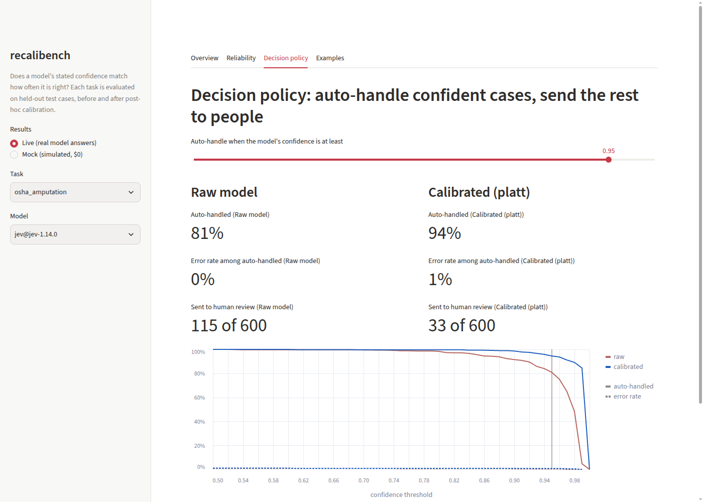
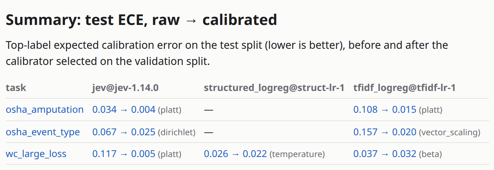
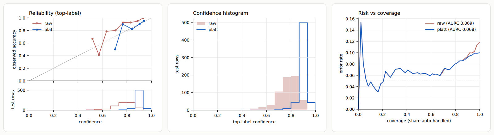
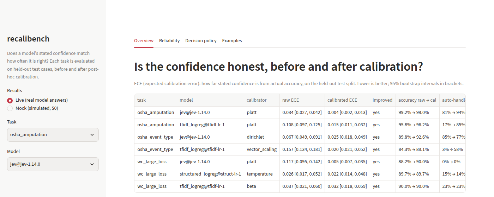

# recalibench

**Measure and fix the confidence of probabilistic decision models, LLM APIs included, using a small labelled sample from your own domain and no retraining.**

Teams act on a model's stated confidence: *auto-approve when it's at least 95% sure, send the rest to a person.* That rule is only safe if "95% sure" means right 95% of the time. recalibench measures how far a model's confidence is from reality on your task, fits a post-hoc calibrator on a few thousand labelled cases, and shows what that buys in automation and errors, with confidence intervals.

It is a plug-in framework. Datasets, tasks, models and calibrators are each one Python file plus one config file. The scoring, calibration, evaluation, HTML report and Streamlit app pick up whatever is plugged in.



## Results: a hosted LLM classification API, measured live

I benchmarked TypeSafe's **Jev** (`jev-1.14.0`) on three tasks built from public data. Each task has 3,000 labelled cases, split 60/20/20 into fit, validation and test sets. Calibrators are fitted on the fit set and selected on the validation set; every number below comes from the 600 held-out test cases (597 for event type). Brackets are 95% paired-bootstrap intervals.

| Task | Question | Raw ECE | Calibrated ECE | Raw model was |
| --- | --- | --- | --- | --- |
| OSHA amputation | Did this incident result in an amputation? (yes/no) | 0.034 [0.027, 0.042] | **0.004** [0.002, 0.013] | under-confident |
| OSHA event type | Which of 7 event types was it? (choice) | 0.067 [0.049, 0.091] | **0.025** [0.018, 0.049] | over-confident |
| Workers' comp large loss | Will this claim be in the costliest 10%? (yes/no) | 0.117 [0.095, 0.142] | **0.005** [0.007, 0.035] | under-confident |

*ECE (expected calibration error) is the average gap between stated confidence and actual accuracy: 0.117 means the model's confidence was off by about 12 percentage points.*

**What it means in practice**

- **More automation at the same accuracy.** On amputation, auto-handling every case the model is at least 95% sure of covers 81% of cases raw and 94% after calibration, at 99% accuracy. The model was right far more often than it claimed.
- **Fewer broken promises.** On event type, raw Jev claimed 95% more often than it earned. A per-class (Dirichlet) calibrator also lifted accuracy from 89.8% to 92.6%. With the threshold tuned on validation for a 95% accuracy target, coverage rises from 88% to 99%.
- **Honest confidence on a hard task.** Workers' comp is the hardest: the model rarely reaches 95% either way. Calibration still cuts its confidence error from 12 points to under 1.
- **Calibration has to be fitted per task.** A calibrator fitted on amputation and reused on workers' comp gets an ECE of 0.025, five times worse than workers' comp's own calibrator (0.005).
- **Wording matters, and calibration removes it.** Three phrasings of the same amputation question gave raw ECEs of 0.034, 0.048 and 0.047. After calibration all three fall between 0.006 and 0.008.
- **A documented bias that didn't appear.** TypeSafe's docs say Jev leans toward the option listed first. Across three option orders, the first option's probability tracked its true frequency, so no first-option bias showed on this task.
- **Cheap to run.** The full live benchmark (15,000 API requests) cost **$0.55**, against a $5 hard budget cap. Requests averaged about 170 ms.

Calibration lowered test ECE for every task and model, including the two local baselines. Full results with figures are in the self-contained [`reports/report.html`](reports/report.html); download it and open it in any browser.





## What's in the box

- **A reproducible benchmark pipeline**, `recal run` (or `make all`). It covers download, task building with leakage guards, scoring, calibration, evaluation, experiments and the report. Each stage is fingerprinted, so re-runs skip unchanged work.
- **Eight calibrators.** For yes/no tasks: identity, temperature, Platt, beta, isotonic and histogram binning. For multiple choice: temperature, vector scaling and Dirichlet. One is selected per task on validation with a one-standard-error rule that prefers simpler families.
- **Rigorous evaluation.** It reports binned and smooth ECE, Brier score, log loss, accuracy, AUROC and paired-bootstrap intervals, plus selective-prediction metrics: risk-coverage curves, AURC and auto-handle rates under two decision policies.
- **Experiments** on question wording, option order, cross-task transfer and cross-model comparison.
- **A production-minded API client.** It has async requests with bounded concurrency, retries with backoff, a response cache, request batching, pinned model versions, and a shared budget that estimates before spending and refuses to start above the cap.
- **An offline mode.** A simulator stands in for the hosted model, with a known, configurable miscalibration, so the whole pipeline runs and is tested for $0.
- **A single-file HTML report** and a **Streamlit app** with Overview, Reliability, Decision policy and Examples pages. The app has a live box that scores a typed case with the real API and applies the fitted calibrator.



## Quick start

Requires Python 3.13 and [uv](https://docs.astral.sh/uv/).

```bash
git clone https://github.com/dagap/recalibench.git
cd recalibench
uv sync

make all       # the full pipeline in mock mode: offline, free; also builds reports/report_mock.html
make demo      # the Streamlit app at http://localhost:8501
make test      # 300+ tests, offline
make lint      # ruff, pyright (strict), deptry
```

`make all` downloads the two public datasets on first run. If osha.gov blocks the automated download, the command prints how to place the file by hand.

**Live mode** (needs a TypeSafe API key):

```bash
cp .env.example .env            # then add TYPESAFE_API_KEY
make estimate MODE=live         # dry run: cost estimate, nothing is spent
make smoke                      # 20 cases per task against the real API
make all MODE=live              # full run under the budget cap in conf/config.yaml
```

The committed `reports/report.html` and the `artifacts/**/metrics.json` files hold the live results shown above. A fresh clone can open the report and the app's Overview and Reliability pages without running anything. The per-case pages need a local pipeline run.

## How it works

```text
prepare     -> score              -> calibrate         -> evaluate           -> experiments -> report / app
datasets,      every task x model:   fit on fit,          test split only,      wording,       loop over
tasks,         cached, batched,      select on val        bootstrap CIs,        option order,  artifacts/
splits         budgeted                                   selective prediction  transfer
```

Every stage reads and writes through a small set of contracts: typed `Protocol`s for each plug-in type, a Hydra config group as each plug-in registry, and a `metrics.json` per task × model as the single source for the report and the app. A contract test plugs in a toy dataset, task, model and calibrator from outside `src/` and runs them end to end through the CLI, so adding a plug-in never needs pipeline changes.

[`docs/DESIGN.md`](docs/DESIGN.md) covers the architecture, leakage guards, cost model, calibrator selection, evaluation method and limitations in detail.

## Engineering

- **Typed and linted:** Python 3.13, pyright in strict mode, ruff and deptry. Untyped third-party APIs are confined to small adapter modules.
- **Tested:** more than 300 tests, run in parallel:
  - unit tests for metrics, calibrators, splits, label rules and API response parsing;
  - integration tests of the API client against mocked HTTP (rate limits, timeouts, retries, cache, budget);
  - the plug-in contract test;
  - Streamlit `AppTest` checks of every page.
  - Tests cannot open network connections.
- **Careful with data and money:**
  - Labels and leaky fields can never reach a model's input, which a test checks for every task.
  - Calibrators refuse to apply to scores they weren't fitted on.
  - Mock and live outputs can never mix.
  - Only aggregate results are committed: no raw scores, case text or credentials.
- **Measured, not assumed:** the API cost model and the batching gains (2.5× fewer billed tokens for batched yes/no questions) were measured on a small live sample before the full run.

## Project layout

```text
conf/            Hydra configs: one folder per plug-in type, plus experiments
src/recalibench/
  core/          types, protocols, registry, paths, splits
  datasets/      OSHA Severe Injury Reports, workers' comp (OpenML)
  tasks/         task builder, label rules, leakage-safe state
  models/        API base class, Jev adapter, local baselines, simulator, cache, budget
  calibrators/   binary and multiclass families, selection
  evaluate/      metrics, bootstrap, selective prediction
  pipeline/      the stages behind the `recal` CLI
  report/        HTML report (inline SVG figures)
  app/           data layer and live box for the Streamlit app
app/             Streamlit UI
tests/           unit, integration, app tests; toy plug-ins for the contract test
artifacts/       committed live metrics and experiment summaries
reports/         committed live report
```

**Stack:** Python 3.13, uv, Hydra, Typer, pandas/pyarrow, scikit-learn, SciPy, httpx, tenacity, diskcache, matplotlib, Streamlit and Altair, pytest, respx, pyright, ruff.

## Data

- **OSHA Severe Injury Reports**, 2015–2025, from [osha.gov](https://www.osha.gov/severe-injury-reports): a US government work in the public domain. Test fixtures are a 50-row anonymised sample.
- **Workers' compensation claims**, synthetic, from [OpenML 42876](https://www.openml.org/d/42876).

## About

Designed and built by **Pankaj Daga**, using AI pair-programming (Claude Code) for implementation. The problem framing, experiment design, engineering decisions and review are mine.
